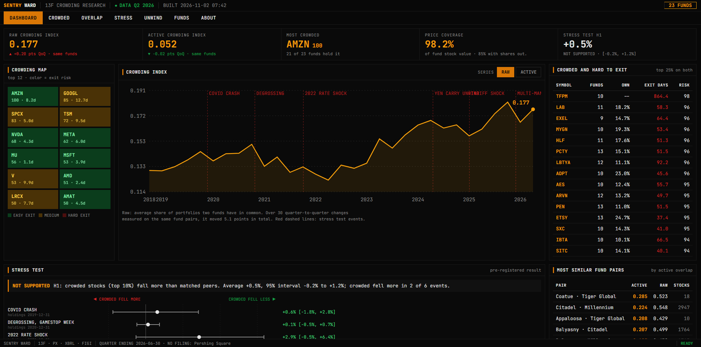
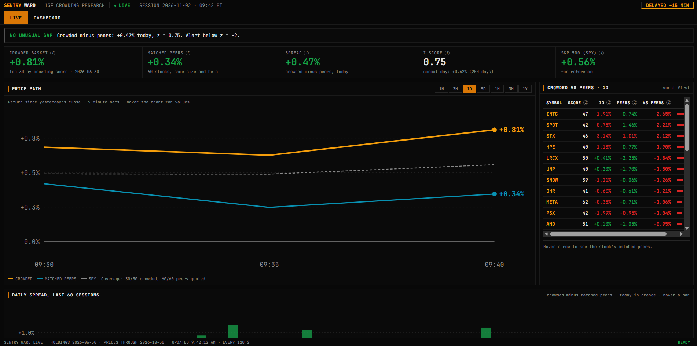

# Sentry Ward

**Hidden crowding among hedge funds, measured from public SEC filings.**




**[Open the dashboard](https://dulguuntsatsralt-cell.github.io/Sentry-Ward/)**: the latest quarter, published with GitHub Pages.

## About

Multi-manager funds run many teams that are supposed to be independent. When those
teams use the same data and models, they end up in the same trades, and a sell-off in
one fund can spread to others. Sentry Ward measures that overlap from the holdings 24
large hedge funds report to the SEC every quarter, then tests whether crowded stocks
actually fall more when markets sell off.

The name comes from Dota, where a sentry ward reveals invisible units. This tool does
the same for crowding hidden behind diversification numbers.

**Headline result:** crowding in the same large stocks rose through 2025, but
crowding in the same independent bets did not. In a pre-registered test over six
sell-offs, crowded stocks did not fall significantly more than comparable stocks. The
one event leaning the other way was the March 2026 multi-manager drawdown. Details in
[RESULTS.md](RESULTS.md).

## Install

| Platform | Command |
|---|---|
| Windows (PowerShell) | `pip install -e ".[dev]"` then set variables with `$env:NAME = "value"` |
| macOS / Linux | `pip install -e ".[dev]"` then set variables with `export NAME="value"` |

| Variable | Needed for | Example |
|---|---|---|
| `SEC_USER_AGENT` | `download`, `market` (SEC requires a contact) | `Your Name your.email@example.com` |
| `WARD_DATA` | where data and results go (default `data`) | `data` |
| `OPENFIGI_API_KEY` | optional, makes `market` much faster | free key from openfigi.com |

Try it without downloading anything:

```bash
export WARD_DATA=demo
ward sample && ward load && ward build && ward report
```

## Commands

| Command | What it does | Time on full data |
|---|---|---|
| `ward download --since 2019` | Downloads SEC 13F data sets (several GB, resumable) | depends on connection |
| `ward load` | Loads them into DuckDB and builds a clean holdings table | 10-20 min |
| `ward build` | Matches funds to filers; scores, overlaps, crowding index | 5-15 min |
| `ward market` | Tickers, prices, volume, shares outstanding (cached) | 5-60 min |
| `ward report` | Prints the latest quarter; writes CSV and JSON | seconds |
| `ward stress` / `ward stress --public` | Runs the pre-registered stress test | a few min |
| `ward dashboard` | Writes one self-contained HTML dashboard | seconds |
| `ward dashboard --site docs` | Writes it as `docs/index.html` for GitHub Pages | seconds |
| `ward live` | Serves the live view of crowded stocks vs matched peers | runs until stopped |
| `scripts/run_all.sh` | Runs every step above from `download` to `dashboard` | sum of the above |

## What's in it

**Data**
- Every 13F holdings report since 2019, with amendments, unit changes and unit errors handled
- Share classes merged by company; ETFs separated from stocks

**Crowding**
- Crowding score per stock, with ownership share, days to exit and exit risk
- Raw and active overlap for every pair of funds; active share per fund
- Quarterly crowding index with like-for-like changes

**Research**
- Pre-registered stress test over six sell-offs, matched on size and beta, with bootstrap intervals
- Unwind simulator using the square-root market impact rule

**Dashboard** (`ward dashboard`)

| Screen | Shows |
|---|---|
| DASHBOARD | KPI strip, crowding map, crowding index, hard-to-exit list, stress result, top pairs |
| CROWDED | The most crowded stocks with ownership, days to exit, exit risk and change |
| OVERLAP | Fund-by-fund matrix (active or raw), grouped by fund style |
| STRESS | Each event's result with 95% intervals; H1/H2, primary/public holdings |
| UNWIND | Estimated price moves if crowded funds sell 10-50% over 1-10 days |
| FUNDS | Funds from most index-like to least; ETFs held most widely |
| ABOUT | Sources, blind spots and method |

## Live view (`ward live`)



`ward live` starts a small local server and opens the live screen in a browser. It
needs the database built by the steps above, including `ward market`.

| Option | Default | Meaning |
|---|---|---|
| `--port` | 8765 | Port to serve on |
| `--host` | 127.0.0.1 | Use `0.0.0.0` inside Docker |
| `--interval` | 120 | Seconds between quote updates (at least 60) |
| `--top` | 30 | Size of the crowded basket |
| `--no-browser` | off | Do not open a browser window |

How it works:

- The **crowded basket** is the top 30 stocks by crowding score in the latest quarter.
  Each one gets two **matched peers** from the same size quintile and beta tercile,
  closest in market value, the same matching the stress test uses.
- Every two minutes the server fetches 1-minute bars from Yahoo Finance (delayed about
  15 minutes) and computes today's return for both baskets since yesterday's close.
- The chart and table switch between ranges: **1H, 3H** (1-minute bars), **1D** (5-minute),
  **5D** (15-minute), and **1M, 3M, 1Y** (daily closes from Yahoo, refreshed every 15 minutes,
  with today's live price as the last point). Your choice is remembered in the browser.
  Yahoo has no bars shorter than 1 minute.
- Hover the price chart for a crosshair with every value at that time, a history bar for
  that day's spread and z-score, a table row for the stock's matched peers, and the
  **i** icons for what each number means.
- The **spread** is crowded minus peers. The z-score divides it by the standard
  deviation of the daily spread over the last 250 sessions. The screen shows an
  **unwind warning** at z = -2 or lower. The z-score always uses today's move, whichever
  chart range is selected.
- The stress test did not find that crowded stocks fall harder in most sell-offs, so a
  warning is a reason to look closer, not a forecast.

### Real-time prices, live news and live TV

With a free [Alpaca](https://alpaca.markets) account (a paper trading account is enough),
`ward live` switches from delayed quotes to real-time ones:

| Variable | What it turns on |
|---|---|
| `APCA_API_KEY_ID`, `APCA_API_SECRET_KEY` | Prices every second and a live news feed |
| `ANTHROPIC_API_KEY` (optional) | One or two sentence summaries for headlines that arrive without one |

- **Prices** update every second during market hours (9:30 to 16:00 New York time). The
  server pushes each update to the browser, so the numbers, chart and table move on
  their own. Outside market hours, or without keys, it uses Yahoo's delayed quotes.
- **The free plan's prices come from one exchange, IEX.** They are real trades in real
  time, but IEX handles a small share of US volume, so a quiet stock can go a while
  between trades. The table marks any stock whose last trade is more than a minute old.
  The basket averages smooth most of this out.
- **News** arrives over a streaming connection seconds after publication. The panel
  shows the headline, a short summary and a link, never the article text. Headlines about
  tracked stocks are highlighted, flagged in the table (**N**) and marked on the
  intraday chart. A headline next to a price move may or may not be its cause.
- **Live TV:** paste a news channel's YouTube live link into the panel. It plays through
  YouTube's own player, muted at first, and the choice is remembered in your browser.
- Options: `--source auto|alpaca|yahoo` (default `auto`) and `--tick SECONDS` (default 1).

Stock and fund pages:

- **Search** in the menu bar finds a stock by ticker, company name or CUSIP, and a fund by name.
- **Stock page** (click any ticker): crowding score by quarter, hedge fund ownership, days
  to exit, and every tracked fund holding it with its value, portfolio weight and whether
  it bought, added, trimmed or sold out since its previous filing.
- **Fund page** (click any fund): 13F value, active share, every holding with its weight
  against the 13F market and its crowding score, new and closed positions, and the funds
  it overlaps with most.
- The pages read the database without locking it, so other `ward` commands can still run.

| Part | Built with | Where |
|---|---|---|
| Real-time prices, news feed, summaries | Python, Alpaca REST and WebSocket APIs, Claude API | `src/sentryward/realtime.py` |
| Push to the browser (`/api/stream`) | Flask, server-sent events | `src/sentryward/server.py` |
| Baskets, history, snapshot | Python, DuckDB | `src/sentryward/live.py` |
| API (`/api/live`, `/api/meta`, `/api/search`, `/api/stock/<key>`, `/api/fund/<name>`) | Flask | `src/sentryward/server.py` |
| Search, stock and fund look-ups | Python, DuckDB SQL | `src/sentryward/explore.py` |
| Live screen | React, Vite | `web/live` (source), `src/sentryward/web/live` (built) |
| Static dashboard script | JavaScript | `src/sentryward/web/dashboard.js` |

The built front end is committed, so `pip install` is enough to run `ward live`. To
change the screen you need Node 20 or later:

```bash
cd web/live
npm install
npm run dev     # hot reload on port 5173, proxies the API to ward live on 8765
npm test        # unit tests for formatting, scales and alert levels
npm run build   # writes the built files into src/sentryward/web/live
```

## Docker

The image installs the package and keeps all data in the `/data` volume.

```bash
docker build -t sentry-ward .
docker run --rm -v ward-data:/data -e SEC_USER_AGENT="Your Name you@example.com" sentry-ward download
docker run --rm -v ward-data:/data sentry-ward load
docker run --rm -v ward-data:/data sentry-ward build
docker run --rm -v ward-data:/data -e SEC_USER_AGENT="Your Name you@example.com" sentry-ward market
docker run --rm -p 8765:8765 -v ward-data:/data sentry-ward live --host 0.0.0.0 --no-browser
```

Then open http://localhost:8765. In PowerShell, use the same commands on one line each.

## Pipeline

| Step | Module | What it does |
|---|---|---|
| `download` | `sec13f.py` | Finds every 13F data set zip on SEC's page and downloads it |
| `load` | `sec13f.py`, `clean.py` | Loads the raw tables into DuckDB, then builds one clean `holdings` table |
| `build` | `metrics.py` | Matches the fund list to filers, computes weights, scores and overlaps |
| `market` | `market.py` | Maps CUSIPs to tickers, downloads prices and shares outstanding, checks matches |
| `report` | `cli.py` | Prints one quarter and exports CSV and JSON |
| `stress` | `stress.py` | Runs the pre-registered stress test |
| `dashboard` | `dashboard.py` | Builds the HTML dashboard from the database |

## Data rules

13F data is messy. Each rule below is a deliberate choice, and each one has a test.

1. **Holdings reports only.** 13F-HR and 13F-HR/A. Notice filings list no positions.
2. **Amendments.** For each filer and quarter, the latest original or restatement is
   used. "New holdings" amendments filed after it are added. An amendment with no
   type is treated as a restatement so positions are never counted twice.
3. **Units.** Filings before 2023-01-03 reported value in thousands of dollars; later
   filings report dollars. Everything is converted to dollars.
4. **Long stock positions only.** Options (PUT/CALL) and principal amounts (bonds)
   are dropped.
5. **Split rows are summed.** One filing can list the same stock several times.
6. **One company, one position.** Share classes of the same company (Alphabet class A
   and C) are combined using the first 6 characters of the CUSIP, which identify the
   issuer. Fund trusts such as iShares or SPDR are not combined, because one trust
   code covers many different ETFs.
7. **Unit errors are fixed, then stray rows dropped.** Some filers kept reporting in
   thousands after the 2023 switch, or the reverse. For each row, the price per share
   (value / shares) is compared with the median price all filers reported for that
   stock. If a filing's typical ratio is about 1/1000 or 1000, the whole filing is
   rescaled. Any row still more than 10x off is dropped. `ward build` prints both
   counts and a per-fund check.
8. **ETFs are separated.** Identified by sponsor names (iShares, SPDR, Invesco
   QQQ, ProShares and others) and words like ETF or INDEX in the title of class.
   Companies with "Trust" in their name, such as Northern Trust, are not flagged.
9. **One fund, many filers.** Filers matching the same name in `universe.csv` are
   combined, so a fund is never compared with itself.

## Market data (`ward market`)

| Data | Source | Notes |
|---|---|---|
| CUSIP to ticker | [OpenFIGI](https://www.openfigi.com/api) | Free. Codes that are not found are retried once: codes starting with a letter (CINS, for companies incorporated outside the US) as `ID_CINS`, and without an exchange filter, keeping US listings. Without a key about 25 requests a minute of 10 CUSIPs; a free key (set `OPENFIGI_API_KEY`) allows 100 CUSIPs per request. |
| Daily prices, volume, splits | Yahoo Finance via `yfinance` | Unofficial. Delisted stocks usually have no data. |
| Shares outstanding | SEC XBRL frames | One request per quarter covers every US filer. Foreign companies (ADRs) are usually missing. |

Everything is cached, so rerunning only fetches what is missing.

Checks:
- **Splits.** Yahoo adjusts old prices and volumes for later splits. 13F share counts
  are as reported at the time, so the split adjustment is undone before comparing.
- **Wrong tickers.** Tickers get reused after companies disappear. A stock's
  quarter-end close must be within 0.8x to 1.25x of the median price per share 13F
  filers reported, or its market data is not used.
- `ward market` prints how much of the funds' stock value has usable data.

Known gaps: stocks that were later delisted often have no Yahoo data, which matters
for stress tests (failed companies drop out). For share classes merged into one
company, volume comes from the largest class only, so days to exit is overstated.

## Stress test (`ward stress`)

Do crowded stocks fall more than comparable stocks when the market sells off? The
design was written in [PREREGISTRATION.md](PREREGISTRATION.md) and committed before
the test was run on real data, so it could not be tuned to the results.

- **Events:** COVID crash (2020), GameStop-week degrossing (2021), 2022 rate shock,
  yen carry unwind (2024), tariff shock (2025), multi-manager drawdown (March 2026).
- **H1:** top 10% by crowding score vs the rest. **H2:** stocks in the top 25% for both
  crowding and days to exit vs the rest.
- **Matching:** within size x beta buckets, because crowded stocks are often big
  high-beta tech names that fall more in any sell-off. The tests include a case where
  crowded stocks are simply high beta: a plain comparison reports a 6%+ "crowding
  effect", the matched test reports about zero.
- **Statistics:** bootstrap 95% intervals (2,000 resamples, seed 0), a regression
  check, and the same measure in ordinary quarters for comparison.
- `ward stress --public` uses only holdings that were public 45+ days before each event.

**Result ([RESULTS.md](RESULTS.md)): neither hypothesis is supported.** Averaged over the
six events, crowded stocks did not fall significantly more than matched peers (H1: +0.5%,
95% interval -0.2% to +1.2%; with public holdings -0.2%, -1.0% to +0.6%). The one event
leaning the other way is the March 2026 multi-manager drawdown, the sell-off most
directly blamed on crowding (-1.1%, interval -2.2% to +0.1%).

## Metric definitions

- `weight`: position value / fund's total stock value that quarter (ETFs excluded)
- `market_weight`: the stock's share of all 13F filers' combined stock holdings, used
  as the "no view" baseline
- `overweight`: max(weight - market_weight, 0)
- `active_share`: sum of a fund's overweights (0 = holds the market)
- `holder_share`: funds holding the stock / funds in the universe
- `sum_weight`: sum of all funds' weights in the stock
- `hf_ownership`: shares held by the universe / shares outstanding (needs market data)
- `days_to_exit`: shares held / (20% of average daily volume) (needs market data)
- `crowding_score`: 0 to 100, among stocks held by at least 2 funds: the average of
  `holder_share` and `sum_weight`, each divided by the quarter's highest value.
- `exit_risk`: 0 to 100, where market data exists: average percentile rank of
  `hf_ownership` and `days_to_exit`. Kept separate from the crowding score so missing
  market data never moves a stock's rank.
- `crowding_rank`: position in the quarter's list, 1 = most crowded
- `overlap(A, B)`: sum over stocks of min(weight_A, weight_B)
- `active_overlap(A, B)`: sum of min(overweight_A, overweight_B) divided by sum of
  max(overweight_A, overweight_B). 0 = no shared bets, 1 = identical bets
- `crowding_index` / `active_index`: average raw / active overlap across fund pairs
- `raw_change` / `active_change`: average change over pairs present in both quarters

## Fund universe

`data/universe.csv` lists funds by name pattern. `ward build` prints which SEC
filers each pattern matched and which matched nothing. Check that list: names change
over time and some firms file under several entities.

## What 13F cannot show

- Short positions, futures, swaps and non-US stocks are not reported, so true
  crowding is likely higher than measured.
- Filings come quarterly, up to 45 days after quarter end.
- Some funds get confidential treatment for certain positions.

## Tests

```bash
pytest                       # Python: pipeline, metrics, stress test, live mode, API
cd web/live && npm test      # JavaScript: live screen helpers
```

GitHub Actions runs the Python tests on Windows, macOS and Linux (Python 3.11 and
3.13) with strict text encoding checks, runs the JavaScript tests and checks the
committed front-end build is current, and builds the Docker image.

The tests use synthetic filings small enough to check by hand. For example, three
sample funds have overlaps of 0.80, 0.25 and 0.25, so the crowding index must be
1.30 / 3. See `src/sentryward/sample.py`.

## Roadmap

- [x] 13F download, loading and cleaning
- [x] Crowding scores, fund overlap, crowding index
- [x] Market data: prices, volume, shares outstanding (CUSIP to ticker mapping)
- [x] Stress tests: do crowded stocks fall harder in sell-offs? (pre-registered)
- [x] Unwind simulator (square-root impact model, in the dashboard)
- [x] Dashboard (`ward dashboard`)
- [x] Live view with delayed quotes (`ward live`)
- [x] Stock and fund pages with search
- [x] Real-time prices (IEX), live news with summaries, live TV panel
- [x] Docker image and pipeline script

## Contributing

Issues and pull requests are welcome. Useful additions: more funds in
`data/universe.csv`, other sell-off events (added as a new pre-registration, not by
editing the existing one), and better sources for sector data. Run `pytest` before
opening a pull request.

## License

MIT. See [LICENSE](LICENSE).

The terminal look is inspired by [Fincept Terminal](https://github.com/Fincept-Corporation/FinceptTerminal).
No code from that project is used.
